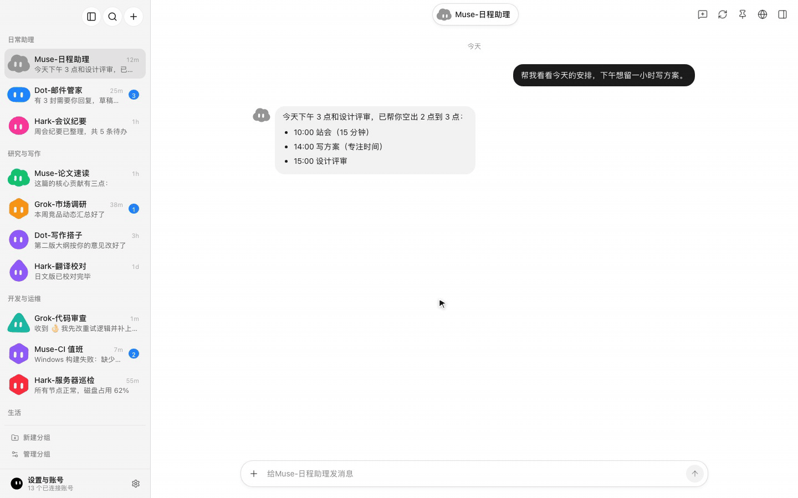

<p align="center">
  
</p>
<p align="center"><sub>演示使用虚构的示例数据：切换 Bot、发送消息并实时看到回复，再查看 Bot 的定时任务和记忆。</sub></p>

<div align="center">

# BotHub

**把所有个人 AI 智能体收进一个桌面工作台**

[](https://github.com/qybaihe/bothub/releases/latest)
[](https://github.com/qybaihe/bothub/actions/workflows/ci.yml)
[](./LICENSE)
[](https://github.com/qybaihe/bothub/releases/latest)

[](https://github.com/qybaihe/bothub/releases/latest)
[](https://github.com/qybaihe/bothub/releases/latest)

[English](./README.md) · **简体中文** · [繁體中文](./README.zh-TW.md) · [日本語](./README.ja.md)

</div>

---

## 项目简介

**BotHub** 是一款基于 Electron、React、TypeScript 与 Tailwind CSS 构建的 macOS / Windows 桌面端 AI 智能体中枢。它将多个个人 AI Agent 平台（**Meta Muse**、**Grok Bot**、**Hark**、**Dot**）聚合在统一的原生界面中；每个 **Bot** 绑定独立隔离的账号会话（`partition`），支持同平台多账号并行在线、实时流式对话、云端电脑/工具调用检视以及集中式管理中心。

<div align="center">
<picture>
  <source media="(prefers-color-scheme: dark)" srcset="docs/assets/bothub-dark.webp">
  
</picture>
</div>

<p align="center"><sub>截图使用虚构的示例数据：侧边栏按分组列出 Muse、Dot、Hark、Grok Bot 上的多个 Bot。</sub></p>

## 已接入平台一览

| 平台 | 协议与传输层 | 核心能力支持 |
| :--- | :--- | :--- |
| **Meta Muse** (`muse.ai`) | 独立 Electron Partition + 原生 WebSocket 网关 | 多账号隔离登录、邮箱验证码批量导入、单账号独立 HTTP/SOCKS5 代理、云端电脑（Computer）状态检视、目标（Goals）、协作节点（Peers）、工作区文件、连接器审批与诊断 |
| **Grok Bot** (`grok.com`) | Sand 网关 (`*.sand.x.ai`) Connect-RPC / Protobuf | 多账号隔离登录、Sand 云端工作区同步、实时流式输出、工具调用轨迹展示、以及可交互的 `GrokBotMark` 动态几何角色头像引擎 |
| **Hark** (`hark.com`) | WebSocket RPC + 多模态 REST 接口 | 浏览器登录与会话恢复、流式对话与后台异步回复轮询、图片/文件多模态上传与下载、原生文档卡片预览、定时任务、用户记忆（Memories）与连接器管理 |
| **Dot** (`chatgpt.com/dots`) | OpenAI Orbit/TBO REST + SSE 实时流 | 支持浏览器 OAuth 登录及 ChatGPT Access Token (`AT`) / Refresh Token (`RT`) 直接导入、基于系统钥匙串 `safeStorage` 的凭据加密存储、SSE 实时流式生成、文件上传、技能（Skills）、定时任务与连接器管理 |

## 核心特性

- **原生级多账号会话隔离**
  每个账号运行在独立的 Electron `persist:` 分区或加密凭据槽位中，同一平台可同时挂载多个账号与多个 Bot，互不串号。
- **全功能管理中心（Management Console）**
  内置全屏管理视图（`SettingsView`），提供全局概览大盘、按平台/状态/关键字筛选的 Bot 列表、一键批量连通性检测，以及针对四大平台的专属账号、Token 与代理管理面板。
- **深度适配的 Agent 聊天与产物体验**
  - 完整呈现思考过程（Thinking Trace）、工具执行卡片（Tool Invocations）、长耗时任务后台防断流恢复（Watchdog & Background Polling）。
  - 支持原生文档弹窗预览（`NativeDocumentDialog`）、Markdown 表格与代码高亮、多模态附件上传与本地保存。
- **动态几何角色头像（`GrokBotMark`）**
  所有 Bot 默认配备可随鼠标视线互动、思考状态律动的 `GrokBotMark` 动态几何角色头像，同时支持随时切换形状/配色或上传自定义头像图片。
- **凭据安全与隐私保护**
  - 本地持久化的敏感凭据（如 Dot 的 `AT`/`RT` 及账号代理密码）默认通过 Electron `safeStorage`（macOS Keychain）加密并以 `0600` 权限落盘。
  - 代码库零硬编码密钥、无任何第三方隐私遥测。
- **可靠投递**
  消息会显示「发送中」「已送达 · 回复中」「没有收到回复」或「发送失败」。平台已经收到的消息不会再被当成未发送，重试不会重复发出。

## 安装说明

从 [最新 Release](https://github.com/qybaihe/bothub/releases/latest) 下载：

| 系统 | 文件 |
| :--- | :--- |
| macOS（Apple 芯片） | `BotHub-<版本>-arm64.dmg` |
| macOS（Intel） | `BotHub-<版本>-x64.dmg` |
| Windows 10/11（x64） | `BotHub-Setup-<版本>-x64.exe` |

> **macOS（未签名）**：把 `BotHub.app` 拖进「应用程序」后，第一次请右键点击 →「打开」（或在「系统设置 → 隐私与安全性」里点「仍要打开」）。也可以在终端移除隔离属性：
>
> ```bash
> xattr -cr /Applications/BotHub.app
> ```
>
> **Windows（未签名）**：如果 SmartScreen 提示「Windows 已保护你的电脑」，点「更多信息 → 仍要运行」。

更新：Windows 版会在后台从 GitHub Releases 下载新版本，一键安装；macOS 版会提示有新版本并打开下载页。

## 本地开发与构建

```bash
npm ci
npm run dev          # 启动 Electron + Vite 热更新
```

| 命令 | 说明 |
| :--- | :--- |
| `npm run dev` | 启动 Electron 主进程、preload 与 React 渲染层（热更新） |
| `npm run dev:web` | 只在浏览器里运行界面（不启动 Electron、不登录账号） |
| `npm run typecheck` | 检查 Node 与 Web 两端类型 |
| `npm test` | 单元测试（Vitest） |
| `npm run build` | 类型检查并构建到 `out/` |
| `npm run dist:mac` / `npm run dist:win` | 打包 macOS `dmg` + `zip`（arm64 + x64）/ Windows NSIS 安装包到 `release/` |
| `npm run dist:dir` | 生成未打包的 macOS arm64 应用，便于冒烟测试 |

README 截图由虚构数据生成：`npx -y -p playwright@1.64 node scripts/screenshot/capture.mjs [--dark]`。

## 发布流程

每次推送都会由 CI（`.github/workflows/ci.yml`）在 macOS 与 Windows 上做类型检查、测试、构建和打包。

1. 修改 `package.json` 的 `version` 并合入 `main`。
2. 推送与版本一致的 tag：`vX.Y.Z`。
3. `release.yml` 会先建草稿 Release，分别构建 macOS（arm64 + x64 的 `dmg`/`zip`、`latest-mac.yml`）和 Windows（NSIS `exe`、`latest.yml`）并上传，确认文件齐全后自动发布。

默认不签名。配置仓库密钥 `CSC_LINK`、`CSC_KEY_PASSWORD`、`APPLE_ID`、`APPLE_APP_SPECIFIC_PASSWORD`、`APPLE_TEAM_ID`（macOS）或 `WIN_CSC_LINK`、`WIN_CSC_KEY_PASSWORD`（Windows）后会自动签名与公证。

## 目录结构

```text
src/
  adapters/        四大平台适配器（Meta Muse、Grok Bot、Hark、Dot）与统一 PlatformAdapter 接口
  main/            Electron 主进程
    muse/          Muse 分区会话管理、批量自动登录、单账号代理路由与测速
    muse-native/   Muse 原生 WebSocket 网关客户端（云端电脑、工作区文件、工具审批等）
    grok/          Grok Bot Sand 鉴权、Connect-RPC 客户端与 IPC 通道
    hark/          Hark WebSocket/REST 客户端、多模态附件上传与 IPC 通道
    dot/           OpenAI Dot (Orbit/TBO) 客户端、safeStorage 加密凭据库、SSE 流与 IPC 通道
  preload/         通过 contextBridge 暴露给渲染进程的类型安全 API (window.bothub)
  shared/          主进程与渲染进程共享的 IPC 协议与类型定义
  renderer/        React + Tailwind CSS + Zustand 渲染层界面
    components/    侧边栏、聊天区、右侧平台检视面板、全屏管理中心、GrokBotMark 角色引擎
    store/         Zustand 全局 Bot 状态管理、流式消息聚合与本地持久化
```

## 协议与接口文档

四大平台适配器的底层传输协议、鉴权流程与接口规范位于 [`docs/`](./docs/README.md) 目录：

- **OpenAI Dot (`chatgpt.com/dots`)**：[`docs/dot/protocol.md`](./docs/dot/protocol.md) — OAuth PKCE 与网页登录鉴权、`/backend-api/tbo` Orbit 实例、`/backend-api/calpico/rooms` SSE 与 REST、`/backend-api/otp/ws` JSON-RPC 2.0 WebSocket、Dynamic Pages、文件库与跨账号记忆迁移
- **Meta Muse (`muse.ai`)**：[`docs/museai/protocol.md`](./docs/museai/protocol.md) — `Noise_XX_25519_ChaChaPoly_SHA256` 加密 WebSocket 握手与 65+ JSON-RPC 方法全集
- **xAI Grok Bot (`grok.com`)**：[`docs/grokbot-protocol/protocol.md`](./docs/grokbot-protocol/protocol.md) — Connect-RPC (HTTP/2) 单次与流式调用、Sand 鉴权、技能、记忆、定时任务与云端沙盒
- **Hark (`hark.com`)**：[`docs/hark/protocol.md`](./docs/hark/protocol.md) — REST + NDJSON 流式对话、连接器、定时任务、VM 文件树与远程桌面会话

## 开源协议

基于 [MIT License](./LICENSE) 开源。
