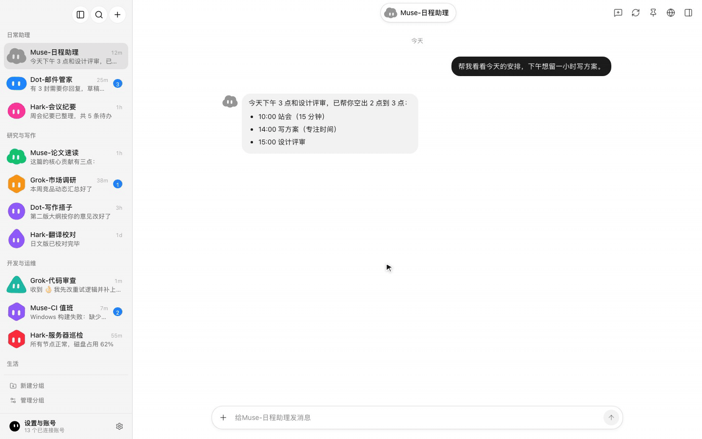

<p align="center">
  
</p>
<p align="center"><sub>示範使用虛構的範例資料：切換 Bot、傳送訊息並即時看到回覆，再查看 Bot 的排程任務與記憶。</sub></p>

<div align="center">

# BotHub

**把所有個人 AI 智慧體收進一個桌面工作台**

[](https://github.com/qybaihe/bothub/releases/latest)
[](https://github.com/qybaihe/bothub/actions/workflows/ci.yml)
[](./LICENSE)
[](https://github.com/qybaihe/bothub/releases/latest)

[](https://github.com/qybaihe/bothub/releases/latest)
[](https://github.com/qybaihe/bothub/releases/latest)

[English](./README.md) · [简体中文](./README.zh-CN.md) · **繁體中文** · [日本語](./README.ja.md)

</div>

---

## 專案簡介

**BotHub** 是一款基於 Electron、React、TypeScript 與 Tailwind CSS 建構的 macOS / Windows 桌面端 AI 智慧體中樞。它將多個個人 AI Agent 平台（**Meta Muse**、**Grok Bot**、**Hark**、**Dot**）聚合在統一的原生介面中；每個 **Bot** 綁定獨立隔離的帳號工作階段（`partition`），支援同平台多帳號並行在線、即時串流對話、雲端電腦/工具呼叫檢視以及集中式管理中心。

<div align="center">
<picture>
  <source media="(prefers-color-scheme: dark)" srcset="docs/assets/bothub-dark.webp">
  
</picture>
</div>

<p align="center"><sub>截圖使用虛構的範例資料：側邊欄依群組列出 Muse、Dot、Hark、Grok Bot 上的多個 Bot。</sub></p>

## 已接入平台一覽

| 平台 | 協定與傳輸層 | 核心能力支援 |
| :--- | :--- | :--- |
| **Meta Muse** (`muse.ai`) | 獨立 Electron Partition + 原生 WebSocket 閘道 | 多帳號隔離登入、信箱驗證碼批次匯入、單帳號獨立 HTTP/SOCKS5 代理、雲端電腦（Computer）狀態檢視、目標（Goals）、協作節點（Peers）、工作區檔案、連接器審批與診斷 |
| **Grok Bot** (`grok.com`) | Sand 閘道 (`*.sand.x.ai`) Connect-RPC / Protobuf | 多帳號隔離登入、Sand 雲端工作區同步、即時串流輸出、工具呼叫軌跡展示、以及可互動的 `GrokBotMark` 動態幾何角色頭像引擎 |
| **Hark** (`hark.com`) | WebSocket RPC + 多模態 REST 介面 | 瀏覽器登入與工作階段恢復、串流對話與背景非同步回覆輪詢、圖片/檔案多模態上傳與下載、原生文件卡片預覽、排程任務、使用者記憶（Memories）與連接器管理 |
| **Dot** (`chatgpt.com/dots`) | OpenAI Orbit/TBO REST + SSE 即時串流 | 支援瀏覽器 OAuth 登入及 ChatGPT Access Token (`AT`) / Refresh Token (`RT`) 直接匯入、基於系統鑰匙圈 `safeStorage` 的憑證加密儲存、SSE 即時串流生成、檔案上傳、技能（Skills）、排程任務與連接器管理 |

## 核心特性

- **原生級多帳號工作階段隔離**
  每個帳號執行在獨立的 Electron `persist:` 分區或加密憑證槽位中，同一平台可同時掛載多個帳號與多個 Bot，互不串號。
- **全功能管理中心（Management Console）**
  內建全螢幕管理檢視（`SettingsView`），提供全域概覽大盤、依平台/狀態/關鍵字篩選的 Bot 清單、一鍵批次連通性檢測，以及針對四大平台的專屬帳號、Token 與代理管理面板。
- **深度適配的 Agent 聊天與產物體驗**
  - 完整呈現思考過程（Thinking Trace）、工具執行卡片（Tool Invocations）、長耗時任務背景防斷流恢復（Watchdog & Background Polling）。
  - 支援原生文件彈窗預覽（`NativeDocumentDialog`）、Markdown 表格與程式碼高亮、多模態附件上傳與本機儲存。
- **動態幾何角色頭像（`GrokBotMark`）**
  所有 Bot 預設配備可隨滑鼠視線互動、思考狀態律動的 `GrokBotMark` 動態幾何角色頭像，同時支援隨時切換形狀/配色或上傳自訂頭像圖片。
- **憑證安全與隱私保護**
  - 本機持久化的敏感憑證（如 Dot 的 `AT`/`RT` 及帳號代理密碼）預設透過 Electron `safeStorage`（macOS Keychain）加密並以 `0600` 權限落盤。
  - 程式碼庫零硬編碼金鑰、無任何第三方隱私遙測。
- **可靠投遞**
  訊息會顯示「傳送中」「已送達 · 回覆中」「沒有收到回覆」或「傳送失敗」。平台已收到的訊息不會再被當成未傳送，重試不會重複送出。

## 安裝說明

從 [最新 Release](https://github.com/qybaihe/bothub/releases/latest) 下載：

| 系統 | 檔案 |
| :--- | :--- |
| macOS（Apple 晶片） | `BotHub-<版本>-arm64.dmg` |
| macOS（Intel） | `BotHub-<版本>-x64.dmg` |
| Windows 10/11（x64） | `BotHub-Setup-<版本>-x64.exe` |

> **macOS（未簽署）**：將 `BotHub.app` 拖進「應用程式」後，第一次請按右鍵 →「打開」（或在「系統設定 → 隱私權與安全性」中點「強制打開」）。也可以在終端機移除隔離屬性：
>
> ```bash
> xattr -cr /Applications/BotHub.app
> ```
>
> **Windows（未簽署）**：若 SmartScreen 顯示「Windows 已保護您的電腦」，請點「其他資訊 → 仍要執行」。

更新：Windows 版會在背景從 GitHub Releases 下載新版本，一鍵安裝；macOS 版會提示有新版本並開啟下載頁。

## 本機開發與建置

```bash
npm ci
npm run dev          # 啟動 Electron + Vite 熱更新
```

| 指令 | 說明 |
| :--- | :--- |
| `npm run dev` | 啟動 Electron 主行程、preload 與 React 介面（熱更新） |
| `npm run dev:web` | 只在瀏覽器中執行介面（不啟動 Electron、不登入帳號） |
| `npm run typecheck` | 檢查 Node 與 Web 兩端型別 |
| `npm test` | 單元測試（Vitest） |
| `npm run build` | 型別檢查並建置到 `out/` |
| `npm run dist:mac` / `npm run dist:win` | 打包 macOS `dmg` + `zip`（arm64 + x64）/ Windows NSIS 安裝檔到 `release/` |
| `npm run dist:dir` | 產生未封裝的 macOS arm64 應用程式，方便冒煙測試 |

README 截圖由虛構資料產生：`npx -y -p playwright@1.64 node scripts/screenshot/capture.mjs [--dark]`。

## 發佈流程

每次推送都會由 CI（`.github/workflows/ci.yml`）在 macOS 與 Windows 上進行型別檢查、測試、建置與打包。

1. 修改 `package.json` 的 `version` 並合併到 `main`。
2. 推送與版本一致的 tag：`vX.Y.Z`。
3. `release.yml` 會先建立草稿 Release，分別建置 macOS（arm64 + x64 的 `dmg`/`zip`、`latest-mac.yml`）與 Windows（NSIS `exe`、`latest.yml`）並上傳，確認檔案齊全後自動發佈。

預設不簽署。設定儲存庫密鑰 `CSC_LINK`、`CSC_KEY_PASSWORD`、`APPLE_ID`、`APPLE_APP_SPECIFIC_PASSWORD`、`APPLE_TEAM_ID`（macOS）或 `WIN_CSC_LINK`、`WIN_CSC_KEY_PASSWORD`（Windows）後會自動簽署與公證。

## 目錄結構

```text
src/
  adapters/        四大平台轉接器（Meta Muse、Grok Bot、Hark、Dot）與統一 PlatformAdapter 介面
  main/            Electron 主行程
    muse/          Muse 分區工作階段管理、批次自動登入、單帳號代理路由
    muse-native/   Muse 原生 WebSocket 閘道客戶端（雲端電腦、工作區檔案、工具審批等）
    grok/          Grok Bot Sand 驗證、Connect-RPC 客戶端與 IPC 通道
    hark/          Hark WebSocket/REST 客戶端、多模態附件上傳與 IPC 通道
    dot/           OpenAI Dot (Orbit/TBO) 客戶端、safeStorage 加密憑證庫、SSE 串流與 IPC 通道
  preload/         透過 contextBridge 提供給介面的型別安全 API (window.bothub)
  shared/          主行程與介面共用的 IPC 協定與型別定義
  renderer/        React + Tailwind CSS + Zustand 介面
    components/    側邊欄、聊天區、右側平台檢視面板、全螢幕管理中心、GrokBotMark 角色引擎
    store/         Zustand 全域 Bot 狀態、串流訊息彙整與本機持久化
```

## 協定與介面文件

四大平台適配器的底層傳輸協定、鑑權流程與介面規範位於 [`docs/`](./docs/README.md) 目錄：

- **OpenAI Dot (`chatgpt.com/dots`)**：[`docs/dot/protocol.md`](./docs/dot/protocol.md)
- **Meta Muse (`muse.ai`)**：[`docs/museai/protocol.md`](./docs/museai/protocol.md)
- **xAI Grok Bot (`grok.com`)**：[`docs/grokbot-protocol/protocol.md`](./docs/grokbot-protocol/protocol.md)
- **Hark (`hark.com`)**：[`docs/hark/protocol.md`](./docs/hark/protocol.md)

## 開源授權

基於 [MIT License](./LICENSE) 開源。
