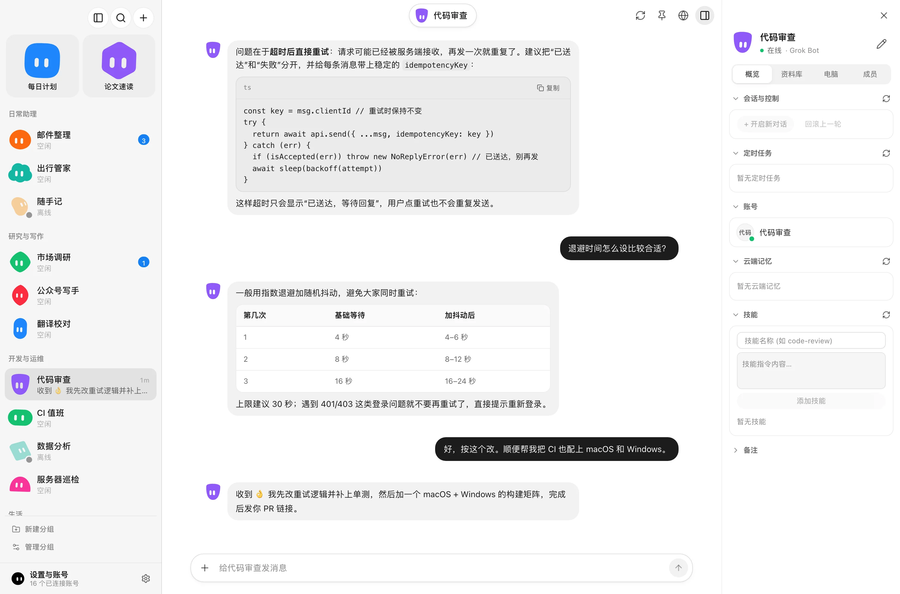

<div align="center">

[English](../../README.md) · [简体中文](README_zh.md) · **繁體中文** · [日本語](README_ja.md) · [한국어](README_ko.md) · [Español](README_es.md) · [Français](README_fr.md) · [Deutsch](README_de.md) · [Português (Brasil)](README_pt-BR.md) · [Русский](README_ru.md) · [Italiano](README_it.md) · [Tiếng Việt](README_vi.md) · [Türkçe](README_tr.md) · [العربية](README_ar.md) · [Bahasa Indonesia](README_id.md) · [हिन्दी](README_hi.md)

<br />


# BotHub

### **集合你的各種 personal agent，在同一個用戶端中像 Grok Bot 一樣使用它們**

**一款 macOS / Windows 桌面應用程式，把 Meta Muse、Grok Bot、Hark 與 Dot 上的 Bot 放進同一個視窗，每個 Bot 都以各自隔離的帳號登入。**

[](https://github.com/qybaihe/bothub/releases/latest)
[](https://github.com/qybaihe/bothub/actions/workflows/ci.yml)
[](#-快速開始)
[](https://www.electronjs.org/)
[](../../LICENSE)

**[⬇️ 下載 macOS 版](https://github.com/qybaihe/bothub/releases/latest) · [⬇️ 下載 Windows 版](https://github.com/qybaihe/bothub/releases/latest) · [📦 所有版本](https://github.com/qybaihe/bothub/releases) · [🐛 回報問題](https://github.com/qybaihe/bothub/issues)**

[快速開始](#-快速開始) · [支援的平台](#-支援的平台) · [功能特色](#-功能特色) · [本機開發](#-本機開發) · [發佈流程](#-發佈流程) · [協定文件](#-協定文件) · [常見問題](#-常見問題)

</div>

---

> [!NOTE]
> BotHub 是獨立開發的用戶端，與 Meta、xAI、Hark、OpenAI 皆無關聯。你以自己的帳號登入，憑證只儲存在你自己的電腦上。

<div align="center">
<picture>
  <source media="(prefers-color-scheme: dark)" srcset="../assets/bothub-dark.webp">
  
</picture>
<sub>截圖使用虛構的範例資料。</sub>
</div>

<br />

<table>
<tr>
<td width="33%" valign="top">

### 🧩 所有智慧體，一個視窗
Muse、Grok Bot、Hark、Dot 的 Bot 並排在側邊欄中依群組排列，每個 Bot 都有自己的對話、詳細資訊面板與設定。

</td>
<td width="33%" valign="top">

### 🔐 帳號彼此隔離
每個帳號都在獨立的工作階段分區或加密憑證槽位中執行，同一平台登入多個帳號也不會互相干擾。

</td>
<td width="33%" valign="top">

### ✅ 可靠投遞
訊息會顯示「傳送中」「已送達 · 回覆中」「沒有收到回覆」或「傳送失敗」。平台已收到的訊息不會再被當成未傳送，重試不會重複送出。

</td>
</tr>
</table>

---

## ⚡ 快速開始

從 [最新版本](https://github.com/qybaihe/bothub/releases/latest) 下載對應系統的檔案：

| 系統 | 檔案 |
| :--- | :--- |
| macOS（Apple 晶片） | `BotHub-<版本>-arm64.dmg` |
| macOS（Intel） | `BotHub-<版本>-x64.dmg` |
| Windows 10/11（x64） | `BotHub-Setup-<版本>-x64.exe` |

> [!TIP]
> 目前的安裝檔尚未進行程式碼簽署。
> - **macOS**：將 `BotHub.app` 拖進「應用程式」，第一次開啟時按右鍵選擇「打開」（或在「系統設定 → 隱私權與安全性」中點「強制打開」）。也可以用 `xattr -cr /Applications/BotHub.app` 移除隔離屬性。
> - **Windows**：若 SmartScreen 顯示「Windows 已保護您的電腦」，請點「其他資訊 → 仍要執行」。

安裝後點側邊欄的 **+**，選擇平台並登入即可。每個 Bot 使用自己的帳號。

**自動更新**：Windows 版會在背景從 GitHub Releases 下載新版本，一鍵安裝；macOS 版會提示有新版本並開啟下載頁。

## 🤖 支援的平台

| 平台 | 協定與傳輸 | 支援的功能 |
| :--- | :--- | :--- |
| **Meta Muse**（`muse.ai`） | 獨立 Electron 分區 + 原生 WebSocket 閘道 | 多帳號、信箱驗證碼批次匯入、單帳號 HTTP/SOCKS5 代理、雲端電腦、目標、協作節點、工作區檔案、連接器審核與診斷 |
| **Grok Bot**（`grok.com`） | 經 Sand 閘道（`*.sand.x.ai`）的 Connect-RPC / Protobuf | 多帳號、Sand 雲端工作區、即時串流輸出、工具呼叫軌跡、工作階段、排程任務、記憶與技能 |
| **Hark**（`hark.com`） | WebSocket RPC + 多模態 REST | 瀏覽器登入（Google 或信箱）、即時串流輸出與背景回覆同步、檔案與圖片附件、文件卡片、排程任務、記憶與連接器 |
| **Dot**（`chatgpt.com/dots`） | OpenAI Orbit/TBO REST + 伺服器推送事件（SSE） | 瀏覽器 OAuth 登入或匯入 Access/Refresh Token、加密儲存權杖、即時串流輸出、檔案上傳、技能、自動化、連接器與單帳號代理 |

## ✨ 功能特色

- **多帳號互不干擾**：每個帳號都在獨立的 Electron `persist:` 分區或加密憑證槽位中，同一平台可以同時登入多個帳號。
- **管理中心**：全螢幕管理檢視，包含整體概覽、Bot 篩選與搜尋、批次連線檢測，以及各平台的帳號、權杖與代理管理。
- **完整的智慧體對話**：即時串流輸出，呈現思考過程與工具卡片；長時間背景任務可自動恢復；支援 Markdown 表格、程式碼高亮、文件預覽與附件下載。
- **Bot 詳細資訊面板**：右側面板依平台顯示工作階段、排程任務、記憶、技能、檔案與成員。
- **會動的頭像**：每個 Bot 都有一個 `GrokBotMark` 動態角色，會跟隨滑鼠、在工作時做出反應；可以更換形狀與配色，也可以上傳照片。
- **預設安全**：權杖與代理密碼透過 Electron `safeStorage`（macOS 上為鑰匙圈）加密，並以 `0600` 權限儲存。程式碼中沒有寫死的金鑰，也沒有任何遙測。
- **中英文介面**，支援淺色與深色主題。

## 🧰 本機開發

```bash
npm ci
npm run dev          # 啟動 Electron + Vite，支援熱更新
```

| 指令 | 說明 |
| :--- | :--- |
| `npm run dev` | 啟動 Electron 主行程、preload 與 React 介面（熱更新） |
| `npm run dev:web` | 只在瀏覽器中執行介面（不啟動 Electron、不登入帳號） |
| `npm run typecheck` | 檢查 Node 與 Web 兩端的型別 |
| `npm test` | 單元測試（Vitest） |
| `npm run build` | 型別檢查並建置到 `out/` |
| `npm run dist:mac` / `npm run dist:win` | 打包 macOS `dmg` + `zip`（arm64 + x64）/ Windows NSIS 安裝檔到 `release/` |
| `npm run dist:dir` | 產生未封裝的 macOS arm64 應用程式，方便冒煙測試 |

README 截圖由虛構資料產生：`npx -y -p playwright@1.64 node scripts/screenshot/capture.mjs [--dark]`。

## 🚀 發佈流程

每次推送，CI（[`ci.yml`](../../.github/workflows/ci.yml)）都會在 macOS 與 Windows 上進行型別檢查、測試、建置與打包。

1. 修改 `package.json` 的 `version` 並合併到 `main`。
2. 推送與版本一致的標籤 `vX.Y.Z`。
3. [`release.yml`](../../.github/workflows/release.yml) 會先建立草稿版本，分別建置 macOS（arm64 + x64 的 `dmg`/`zip`、`latest-mac.yml`）與 Windows（NSIS `exe`、`latest.yml`）並上傳，確認檔案齊全後自動發佈。

預設不簽署。在儲存庫中設定以下密鑰後會自動簽署與公證：`CSC_LINK`、`CSC_KEY_PASSWORD`、`APPLE_ID`、`APPLE_APP_SPECIFIC_PASSWORD`、`APPLE_TEAM_ID`（macOS），或 `WIN_CSC_LINK`、`WIN_CSC_KEY_PASSWORD`（Windows）。

## 📁 目錄結構

```text
src/
  adapters/        各平台轉接器（Meta Muse、Grok Bot、Hark、Dot）與統一的 PlatformAdapter 介面
  main/            Electron 主行程
    muse/          Muse 分區工作階段、批次登入與單帳號代理路由
    muse-native/   Muse 原生 WebSocket 閘道用戶端（雲端電腦、工作區等呼叫）
    grok/          Grok Bot Sand 驗證、Connect-RPC 用戶端與 IPC 處理
    hark/          Hark WebSocket/REST 用戶端、附件上傳與 IPC 處理
    dot/           OpenAI Dot（Orbit/TBO）用戶端、加密權杖庫、SSE 串流與 IPC
  preload/         透過 contextBridge 提供為 window.electron 的型別化 API
  shared/          主行程與介面共用的 IPC 通道約定與型別
  renderer/        React + Tailwind + Zustand 桌面介面
    components/    側邊欄、對話區、詳細資訊面板、各平台面板、管理中心、GrokBotMark
    store/         Bot 狀態、串流訊息合併與本機持久化
scripts/screenshot/  以虛構資料產生 README 截圖
```

## 📚 協定文件

各平台的通訊協定與介面說明位於 [`docs/`](../README.md) 目錄：

- **OpenAI Dot**（`chatgpt.com/dots`）：[`docs/dot/protocol.md`](../dot/protocol.md)：OAuth PKCE 與網頁工作階段驗證、Orbit 設定、聊天室 SSE 與 REST、JSON-RPC 2.0 WebSocket、Pages、資料庫與記憶遷移
- **Meta Muse**（`muse.ai`）：[`docs/museai/protocol.md`](../museai/protocol.md)：`Noise_XX_25519_ChaChaPoly_SHA256` 加密 WebSocket 交握與 65 個以上的 JSON-RPC 方法
- **xAI Grok Bot**（`grok.com`）：[`docs/grokbot-protocol/protocol.md`](../grokbot-protocol/protocol.md)：基於 HTTP/2 的 Connect-RPC 單次與串流呼叫、Sand 驗證、技能、記憶、自動化與雲端沙盒
- **Hark**（`hark.com`）：[`docs/hark/protocol.md`](../hark/protocol.md)：REST 與 NDJSON 串流介面、連接器、排程任務、虛擬機檔案樹與電腦工作階段

## ❓ 常見問題

<details>
<summary><b>BotHub 是這些平台的官方應用程式嗎？</b></summary>

不是。BotHub 是獨立開發的用戶端，與 Meta、xAI、Hark、OpenAI 皆無關聯，使用的是你在各平台上自己的帳號。

</details>

<details>
<summary><b>我的帳號與權杖儲存在哪裡？</b></summary>

只儲存在你自己的電腦上。網頁工作階段儲存在每個帳號獨立的 Electron 分區中；權杖與代理密碼以 `safeStorage`（macOS 上為鑰匙圈）加密，並以 `0600` 權限儲存。BotHub 不會傳送任何遙測資料。

</details>

<details>
<summary><b>macOS 提示無法打開 BotHub，該怎麼辦？</b></summary>

安裝檔目前尚未簽署。按右鍵點應用程式選擇「打開」，或執行 `xattr -cr /Applications/BotHub.app`。詳見[快速開始](#-快速開始)。

</details>

<details>
<summary><b>訊息一直顯示「已送達 · 回覆中」，重試會不會重複傳送？</b></summary>

不會。平台一旦收到訊息，BotHub 就不會再把它當成未傳送。如果一直沒有回覆，會顯示「沒有收到回覆」，並提供「再傳一次」按鈕，明確表示會再傳一則相同的內容。

</details>

<details>
<summary><b>每個帳號可以使用不同的代理嗎？</b></summary>

可以，Muse 與 Dot 帳號支援 HTTP 或 SOCKS5 代理。如果代理無法生效，BotHub 會阻擋該帳號的網路請求，而不是改用直連。

</details>

## 📄 授權

以 [MIT 授權條款](../../LICENSE) 開源。
